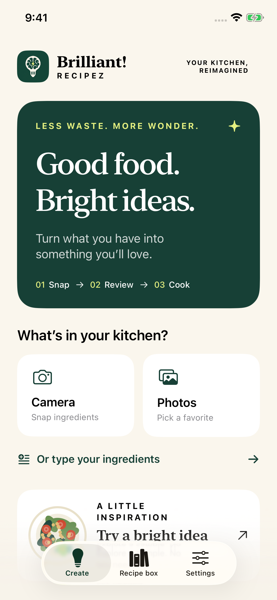
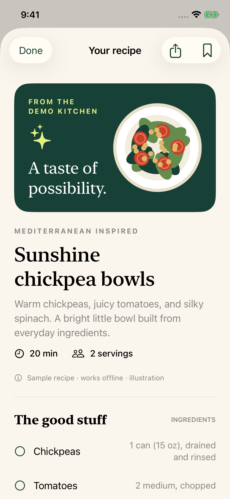
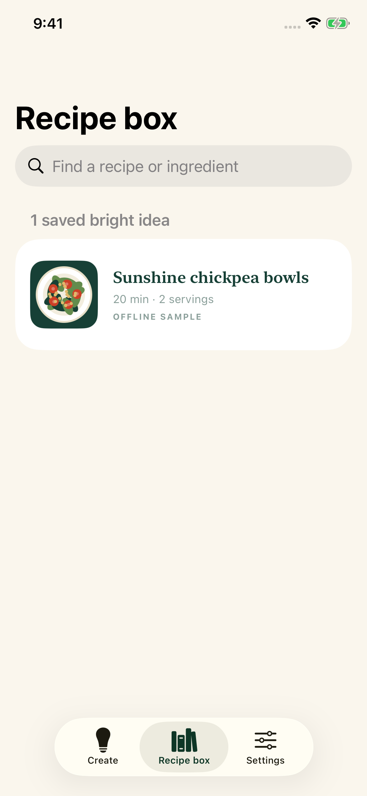

# Brilliant! Recipez


**Turn what you have into something worth cooking.**

An open-source iOS prototype for builders: take a photo, review the ingredients, and ask Grok for a recipe. Built fresh with SwiftUI, a small Swift package, and room to make it your own.

> **Bring your own Grok API key.** You need your own valid xAI/Grok API key, access to a compatible model, and any required credits for AI recipe generation and photo recognition to function. No API key is included. The offline demo is a fixed sample, not live AI.
>
> **API compatibility can change.** Specific APIs and models—including older **VISION / image-understanding APIs**—may no longer be supported when you use this project. Changes can affect recognition quality, speed, cost, or functionality. The text and vision model IDs are editable in Settings. Check the current [xAI model catalog](https://docs.x.ai/developers/models) before relying on them.

## About

Brilliant! Recipez is a foundation for your own cooking app. The flow is simple: capture or choose a photo, correct the detected ingredients, choose your preferences, and generate a recipe. You can also start by typing ingredients. Save recipes on your device and share them as plain text.

The project includes a working offline path so you can explore the interface and start building without credentials. Live AI requests go directly from the app to xAI using the key you enter. There is no project-operated backend, subscription system, trial counter, or advertising SDK.

This is a prototype, with the source and integration boundaries exposed for other builders. It is not an App Store release or a guarantee that any third-party model will remain available.

## A look inside

| Start with your ingredients | Make it a meal | Keep your favorites |
| --- | --- | --- |
|  |  |  |

The interface also supports a [dark appearance](docs/screenshots/home-dark.png).

## What you can build on

- **Camera and photo library:** import a food photo, resize it, and send it for ingredient recognition.
- **Review before generating:** correct the ingredient list and add anything the photo missed.
- **Manual ingredients:** use the app without a photo.
- **Your kitchen, your preferences:** choose pantry staples, servings, time, and a cooking direction.
- **Recipe collection:** save recipes locally, reopen them, and share readable text.
- **Editable AI configuration:** supply your key and choose separate text and vision model IDs.
- **An honest offline demo:** inspect a bundled sample without making a network request.
- **A reusable core:** Foundation models, networking, validation, and tests live outside the SwiftUI interface.

## Open it in Xcode

You need macOS, **Xcode 16 or newer**, and an **iOS 17+** simulator or device. The repository includes its local Swift package; no third-party SDK installation is required.

```sh
git clone https://github.com/LoganVoss/brilliant-recipez.git
cd brilliant-recipez
open BrilliantRecipez.xcodeproj
```

Select the **BrilliantRecipez** scheme, choose an iPhone simulator, and run. The shared scheme is checked in.

For a physical device, choose your Apple development team in **Signing & Capabilities** and use a bundle identifier you control. Camera capture requires a device with a camera. The simulator can exercise the offline demo, manual input, and imported sample photos.

### Try it without a key

Tap **Try a bright idea** on the home screen to load the included sample. You can inspect a recipe, save it, and reopen it from your collection. Demo content is explicitly labeled. It does not inspect your photo or generate a recipe from your ingredients.

### Connect Grok

1. Create your own API key in the [xAI Console](https://console.x.ai/).
2. Open the app's **Settings**, enter the key, and save it. The app stores it in the iOS Keychain.
3. Check the configured text and vision models. Both default to `grok-4.7`, which the [official developer guide](https://docs.x.ai/developers/grok-4-7) listed as accepting text and images when reviewed on October 22, 2026.
4. Enter ingredients or select a photo, review the ingredient list, and request a recipe.

API usage is billed by the provider to your account. A Grok consumer subscription should not be assumed to provide API credits. Review your account's access, limits, and current [pricing](https://docs.x.ai/developers/pricing).

**Do not paste keys into source code, issues, screenshots, or commits.** The historic credentials were not reused or included in this rebuild. A shared production app should use an authenticated backend with appropriate rate and spending controls rather than embedding a shared provider key in the app.

## API compatibility and limitations

The prototype uses `POST https://api.x.ai/v1/chat/completions` with JSON output. xAI still documents this endpoint, but classifies it as **legacy** and recommends the Responses API for new integrations. The networking layer is isolated so builders can migrate it. See the [Chat Completions documentation](https://docs.x.ai/developers/model-capabilities/legacy/chat-completions) and [migration guide](https://docs.x.ai/developers/model-capabilities/text/comparison).

Photo recognition requires a model that accepts image inputs. An old model ID containing “vision” is not a guarantee of support. Conversely, current image-capable models may not have “vision” in their names. The [image-understanding guide](https://docs.x.ai/developers/model-capabilities/images/understanding) documents current image formats and limits.

The app validates the structure of AI responses and checks recipe fields before presenting them. That cannot prove that a recipe is safe, correctly timed, nutritionally accurate, or compatible with an allergy. Ingredient recognition can miss or misidentify items. Review the result and use your own cooking judgment. Preferences are prompt guidance, not certified dietary or allergy filtering.

Recipe image generation is intentionally absent. The prototype focuses on identifying ingredients and producing usable text recipes without another paid or potentially retired image-generation dependency.

### If a live request fails

| Symptom | Check |
| --- | --- |
| Missing key or authentication failure | Save your own current key in Settings; confirm it is active in the xAI Console. |
| Model unavailable or image request rejected | Check account access and the model ID; choose an image-capable model for vision. Use manual entry if photo recognition is unavailable. |
| Rate limit or exhausted credit | Check your provider account's limits and balance; wait before trying again. |
| Request times out | Check connectivity and provider status. A reasoning model can take longer to respond. |
| Response cannot be decoded | The provider may have changed its output, or the response may be incomplete. Try again, then inspect the core client's schema and parsing code. |

Never include an API key or a private food photo in a bug report.

## Verify and package

Run the repository checks from the project root:

```sh
./scripts/verify.sh
```

The project also includes an optional simulator UI test runner and a packaging script:

```sh
./scripts/test-ui.sh
./scripts/package.sh
```

`verify.sh` runs the core tests and a generic simulator build. Use `test.sh` or `build.sh` to run those separately. `test-ui.sh` selects an available iPhone simulator; you can also pass `"platform=iOS Simulator,id=<UDID>"`. The default Debug build is written to `build/DerivedData/Build/Products/Debug-iphonesimulator/BrilliantRecipez.app`.

`package.sh` requires a clean, committed working tree and archives tracked source from `HEAD`. Its default output is `../BrilliantRecipez-source.zip`; pass another ZIP path as its first argument. This is a source bundle, not a signed IPA.

The GitHub Actions workflow runs core tests, builds the simulator app, and runs the offline UI tests. Simulator builds use ad-hoc signing so Keychain works without an Apple developer account. These checks use local fixtures; they do not require an API key or spend API credits.

**Live API validation:** this rebuild did not reuse the expired key and has not been tested against a live xAI account. Compilation and fixture tests do not establish current model access or end-to-end provider behavior. Test with your own key before extending or distributing the live integration.

Local verification passed **19 core tests and 5 UI tests**, plus simulator and unsigned device Release compilation. See [validation notes](docs/VALIDATION.md) for the tested environments and limits.

The [0.1.0 prototype release](https://github.com/LoganVoss/brilliant-recipez/releases/tag/v0.1.0) includes a source ZIP and an ad-hoc-signed **iOS Simulator app**. The simulator app is not an iPhone IPA or App Store package. After extracting it, install with `xcrun simctl install booted BrilliantRecipez.app` and launch `com.loganvoss.brilliantrecipez` on a compatible booted simulator.

## Project layout

```text
BrilliantRecipez.xcodeproj/  Xcode project and shared scheme
BrilliantRecipez/           SwiftUI app, platform integrations, and assets
Packages/RecipeCore/        Models, API client, validation, and core tests
scripts/                   Verification, UI testing, and source packaging
docs/                      Architecture, privacy, and screenshots
```

Read the [architecture notes](docs/ARCHITECTURE.md) for extension points and the [privacy notes](docs/PRIVACY.md) for what stays on the device and what is sent to xAI.

## Make it yours

Fork it, improve it, and use it as a starting point for your own idea. A few useful next steps: migrate to Responses, add a backend, improve ingredient review, strengthen dietary checks, or build a meal-planning flow. Keep the offline demo and provider boundary easy to test as you grow the app.

Contributions are welcome. See [CONTRIBUTING.md](CONTRIBUTING.md) and [SECURITY.md](SECURITY.md).

Created by **Logan Voss**. Released under the [MIT License](LICENSE). Grok and xAI are third-party products; this project is independent and is not affiliated with or endorsed by xAI.
