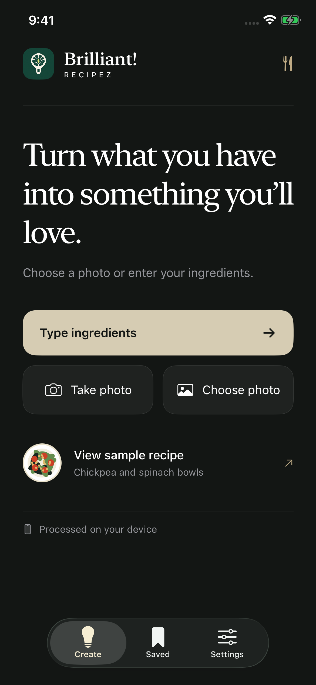

# Brilliant! Recipez


**Turn what you have into something you’ll love.**

An open-source iOS recipe app built with SwiftUI and Apple’s on-device models. Add ingredients, set servings and time, then generate a recipe. Save recipes locally and share them as text.

**No API key, account, backend, or per-generation fee.** New recipes are generated on the device using Apple’s Foundation Models framework. The app does not send ingredients or photos to a cloud model.

## Screenshots

| Create | Dark appearance | Sample recipe |
| --- | --- | --- |
|  |  |  |

Captured in the iOS 26.5 simulator. The recipe shown is the labeled, fixed sample.

## Requirements

- **Xcode 27 or newer** to build the project.
- **iOS 26 or newer** to run the app.
- An **Apple Intelligence-compatible device**, with Apple Intelligence enabled and its model downloads complete, for recipe generation.
- A supported system language and region. Check [Apple’s current requirements](https://support.apple.com/en-us/121115).

An iOS version alone does not guarantee model access. The app checks model availability and explains when the device is unsupported, Apple Intelligence is off, or models are not ready. Apple manages model downloads and may need internet access for setup and updates; generation runs locally once the required model is available. The bundled sample and saved recipes remain accessible when generation is unavailable.

## Run it

```sh
git clone https://github.com/LoganVoss/brilliant-recipez.git
cd brilliant-recipez
open BrilliantRecipez.xcodeproj
```

Select the **BrilliantRecipez** scheme and run on an iPhone simulator or device. No third-party package installation or credential setup is required.

For a physical device, create the ignored file `Config/Signing.local.xcconfig` with your development team identifier:

```xcconfig
DEVELOPMENT_TEAM = YOUR_TEAM_ID
```

The shared signing configuration includes it when present. Use a bundle identifier you control and check **Signing & Capabilities** in Xcode. Keep your local signing file out of commits; simulator builds do not require a development team.

1. Choose **Type ingredients**, **Take photo**, or **Choose photo**.
2. For a photo, tap **Find ingredients**. Review the list, then set servings, time, and style.
3. Tap **Create recipe**. Tap the bookmark to keep the result in the **Saved** tab.

**View sample recipe** opens a fixed example. It does not generate from your ingredients. Simulator tests use fixtures and availability states; use a supported physical device to evaluate the actual model and camera.

## Photo support

| Environment | Recognition path |
| --- | --- |
| iOS 27+ with an available model that supports images | Pass the selected image to Apple’s on-device model for ingredient suggestions. |
| iOS 26, or an image-ineligible model | Run Apple Vision image classification and English text recognition locally, then match a limited food vocabulary. Many photos will need manual corrections. |
| No useful suggestions | Enter or correct the ingredients manually. |

Review every suggestion before generating. Photos can contain ingredients that recognition misses, and packaging text can describe food that is not actually present. There is no cloud fallback. Apple documents the newer image path in [Analyzing images with multimodal prompting](https://developer.apple.com/documentation/foundationmodels/analyzing-images-with-multimodal-prompting).

## What’s included

- Camera capture, photo import, and editable ingredient lists.
- On-device recipe generation in English, with typed output and ingredient validation.
- Servings, maximum cooking time, recipe style, and optional pantry basics.
- Saved recipes with local persistence, search, ingredient checklists, step checklists, and text sharing.
- Clear model availability and error states, cancellation, and a labeled sample recipe.
- A standalone `RecipeCore` Swift package, test fixtures, build scripts, and GitHub Actions.

This is a prototype for builders, not an App Store release. Model output can be wrong: check ingredients, allergens, and cooking instructions. Structured output and ingredient validation do not certify food safety or dietary suitability. Very sparse ingredient lists may need editing or another attempt when the model returns an invalid recipe. Model behavior can change with system updates; test against the OS versions you support.

## Verify and package

```sh
./scripts/verify.sh
./scripts/test-ui.sh
./scripts/package.sh
```

`verify.sh` runs core tests and a generic simulator build. `test-ui.sh` uses an available iPhone simulator, or accepts a destination such as `"platform=iOS Simulator,id=<UDID>"`. Automated tests do not depend on a downloaded language model.

`package.sh` archives tracked source from a clean, committed `HEAD`. Its default output is `../BrilliantRecipez-source.zip`; pass a different ZIP path as its first argument. This is source code, not a signed iPhone IPA. A compiled simulator app also cannot be installed on a physical iPhone.

See [validation notes](docs/VALIDATION.md) for the checks actually run and the remaining device-testing limits. Build and fixture results are separate from testing live on-device generation.

## Project layout

```text
BrilliantRecipez.xcodeproj/  Xcode project and shared scheme
BrilliantRecipez/           SwiftUI, Apple model and Vision integrations, assets
Packages/RecipeCore/        Shared models, validation, and core tests
scripts/                   Verification, UI testing, and source packaging
docs/                      Architecture, privacy, validation, and brand assets
```

Read the [architecture](docs/ARCHITECTURE.md), [privacy](docs/PRIVACY.md), [contribution](CONTRIBUTING.md), and [security](SECURITY.md) notes before extending the app. Useful next steps include stronger recipe evaluations, a specialized local food recognizer, localization, and meal planning.

Created by **Logan Voss**. App source is released under the [MIT License](LICENSE). Apple’s frameworks and system models are supplied by Apple under their own terms; model weights are not included in this repository. This project is independent and is not endorsed by Apple.
