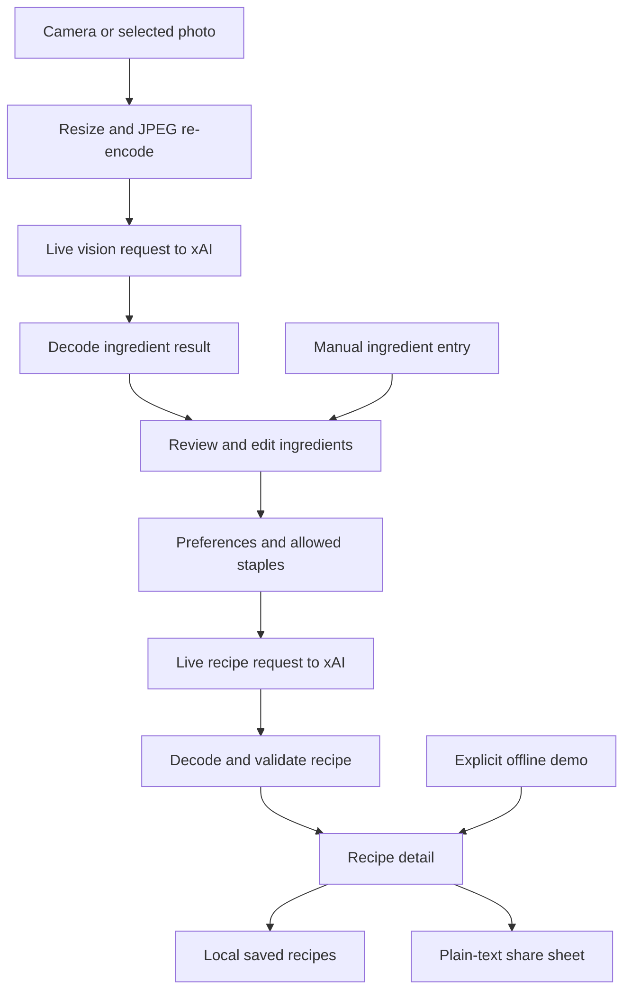

# Architecture

Brilliant! Recipez separates the cooking flow from the AI provider and the iOS interface. The goal is a small foundation that a builder can understand, run without credentials, and extend.

## Boundaries

| Layer | Responsibility |
| --- | --- |
| SwiftUI app | Ingredient input and review, preferences, request state, recipe presentation, saved recipes, Settings, and sharing. |
| iOS integrations | Camera and photo selection, image preparation, Keychain access, and device-local storage. |
| `RecipeCore` | Foundation data types, request construction, provider transport, response decoding, validation, and deterministic fixtures. |
| xAI | Live ingredient recognition and recipe generation. Requires the builder's key, model access, and credits. |

The core is a local Swift package, with no UI framework dependency. The app connects it to SwiftUI state and platform services. `RecipeService` defines the provider boundary; `GrokService` implements it. An injected `URLSession` lets tests intercept requests with `URLProtocol` without reaching the network or handling a real key. `Recipe`, `RecipeIngredient`, `RecipePreferences`, `IngredientNormalizer`, and `GrokConfiguration` are the main shared types.

## Data flow

The user reviews detected ingredients before requesting a recipe. Manual entry remains useful when the camera is unavailable or the selected model cannot process images. It still needs a live API key for AI recipe generation. Only the fixed demo is a no-key substitute for the full flow.

## Provider adapter

The implementation uses Foundation `URLSession` and the documented Chat Completions format. A recipe request includes ingredients, selected staples, and cooking preferences. A vision request sends prepared JPEG data in a base64 data URL. Both request JSON output; the response's text is decoded into application types before use.

Text and vision models are configured independently and initially use `grok-4.7`. Keep the identifiers in configuration rather than distributing credentials in source. A valid identifier is not proof that the account can use that model or that it supports photos.

The endpoint is a deliberate compatibility boundary: xAI currently describes Chat Completions as legacy. A migration to Responses should change the provider adapter, its request/response types, and transport fixtures together. Responses uses `input` instead of `messages`, different image parts, and an `output` array instead of `choices[0].message.content`. Do not simply change the URL. See the [official comparison](https://docs.x.ai/developers/model-capabilities/text/comparison).

JSON output improves parsing reliability; it does not establish factual correctness. See xAI's [structured-output documentation](https://docs.x.ai/developers/model-capabilities/text/structured-outputs).

## Validation and failure behavior

The core accepts at most 30 reviewed ingredients, 80 characters per ingredient, 1–12 servings, 5–180 minutes, and 300 characters of cooking direction. It rejects image data above 8 MiB and responses above 1 MiB.

Recipe validation rejects empty fields or steps, excessive sizes, serving/time mismatches, duplicate or unknown ingredient names, and recipes that use none of the reviewed ingredients. Names must match the normalized reviewed list or permitted staples: water, salt, black pepper, and olive oil. JSON wrapped in a Markdown fence is tolerated; truncated or malformed results are rejected.

HTTP authentication, access, unavailable-model, rate-limit, and server errors are mapped to safe messages. Cancellation propagates. The client does not log keys or raw responses and does not automatically retry requests. A failed live request never becomes unlabeled demo content.

Validation is intentionally narrower than cooking expertise. The prototype cannot machine-prove that every step uses the correct ingredient, that cooking times are sufficient, or that a meal is safe for a particular allergy. “Vegetarian,” time, servings, and similar preferences need semantic testing in addition to schema checks.

Errors and cancellation belong in the user flow. Show a recoverable failure, preserve the user's ingredients, and let them retry intentionally. Avoid silently retrying expensive requests indefinitely or automatically switching to an unknown model with different pricing.

## Images and local data

Imported images are resized to a maximum dimension of 1,600 pixels and re-encoded as JPEG before upload. Re-encoding avoids forwarding original file metadata, but visible identifying information remains in the pixels. The app sends only the selected image for a recognition request; it does not upload the entire photo library.

The API key uses the iOS Keychain’s `WhenUnlockedThisDeviceOnly` accessibility class. Model settings use `UserDefaults`; ingredient input and cooking preferences stay in app state. Saved recipes use `Application Support/BrilliantRecipez/recipes.json`, written atomically with file protection. If the collection cannot be decoded, the app preserves the file and pauses saves rather than overwriting it. The project has no cloud sync service. The operating system's backup behavior is separate from app-level networking. See [PRIVACY.md](PRIVACY.md).

## Extension points

- **Another provider:** implement the core service boundary and preserve the app's recipe and ingredient types. Add fixtures for success, rejection, malformed content, and unavailable image models.
- **Responses migration:** update the adapter and test both text and image bodies, response parsing, error mapping, and storage flags.
- **Production backend:** move a shared service credential to a server, authenticate users, and add request quotas, spending limits, and abuse controls. Do not ship a shared key inside an iOS binary.
- **Better recipe quality:** add repeatable evaluations for ingredient fidelity, substitutions, units, timing, and preference adherence. Keep human review of dietary and cooking claims.
- **Persistence:** add a versioned store and migration tests before changing saved recipe shape. Define export and deletion behavior before adding sync.
- **More platform features:** retain the pure core while expanding the iPad interface, accessibility, localization, or meal planning.

Recipe image generation is outside this prototype's scope. Adding it should be a separate service with its own credentials policy, pricing disclosure, failure state, and tests.

## Verification strategy

Core tests run against deterministic fixtures and mocked transport. Simulator compilation checks the iOS integration. UI tests exercise selected flows without an API key. These are useful separate signals; none validates the provider's current account permissions or the culinary quality of a live response.

The repository's scripts document the checks and packaging process. New behavior should add meaningful tests at the relevant boundary. Do not store keys, user photos, provider account data, or private prompts in fixtures.
