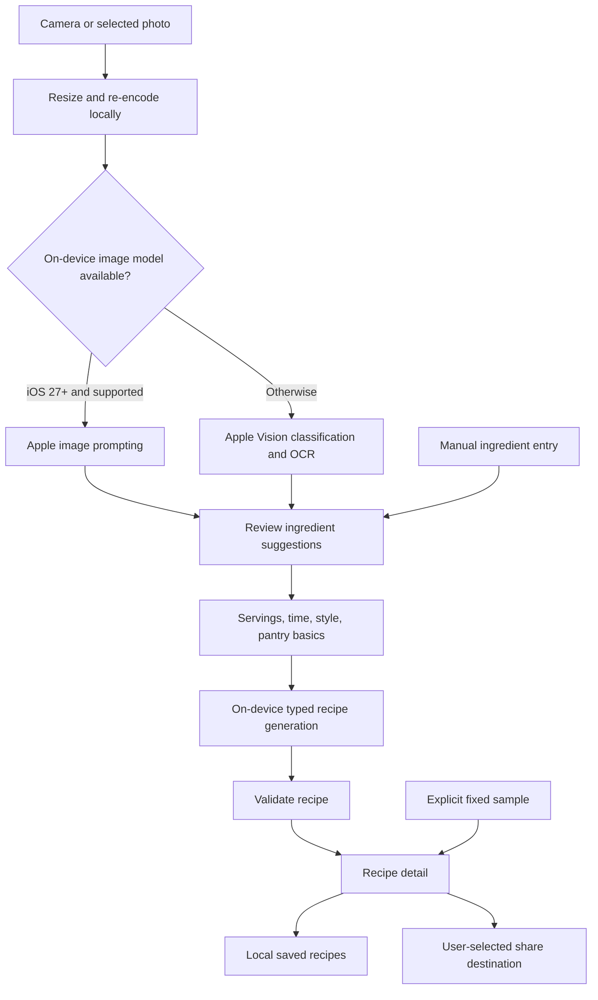

# Architecture

Brilliant! Recipez separates SwiftUI, Apple’s platform APIs, and a small Foundation-only core. Recipe generation and photo recognition stay on the device.

## Boundaries

| Layer | Responsibility |
| --- | --- |
| SwiftUI app | Ingredient review, preferences, progress and errors, recipe display, saved recipes, availability status, and sharing. |
| `AppleRecipeService` | Check runtime availability, prompt the on-device `SystemLanguageModel`, request typed output, and map failures to recoverable messages. |
| `LocalPhotoService` | Use native on-device image prompting on supported iOS 27+ models; otherwise use local Vision classification and text recognition. |
| `RecipeCore` | Recipe and preference types, ingredient normalization, validation, `FoodSuggestionFilter`, and deterministic fixtures. |
| Local persistence | Save recipes in the app container. No sync server. |

The app uses Apple’s Foundation Models framework, not a hosted provider SDK. It creates a session with the on-device `SystemLanguageModel`; it does not configure Private Cloud Compute, external model providers, or a network fallback. Apple describes this model in the [SystemLanguageModel reference](https://developer.apple.com/documentation/foundationmodels/systemlanguagemodel).

## Data flow

A photo is an optional input aid. Recognition never silently proceeds to cooking instructions: the user reviews the list first. `LocalPhotoService` uses native image prompting when available and falls back to Vision when that capability or the model is unavailable. A refusal or other generation error is surfaced rather than silently rerouted.

The Vision fallback runs classification and English OCR off the main actor, then passes sufficiently confident results through `FoodSuggestionFilter`. That filter matches a limited vocabulary of food names and short product labels. It ignores generic labels, uncertain wild-food categories, allergen statements, and labels for prepared foods rather than inferring their contents. This is a conservative suggestion aid, not a complete food detector. Keep manual entry available when a photo produces no useful suggestions.

## Model integration

The app requires iOS 26+. Native image prompting uses the iOS 27+ attachment API behind an availability check and model capability check. The [multimodal prompting guide](https://developer.apple.com/documentation/foundationmodels/analyzing-images-with-multimodal-prompting) describes the newer API.

Recipe generation uses `@Generable` types to constrain the response shape, then converts that output into the existing `Recipe` model and validates it. Recipe prompts request English output and include only the reviewed ingredients, preferences, and allowed staples. The system model and its assets are managed by the OS; no weights are bundled or downloaded by this app.

Runtime availability is separate from OS availability. Check the model before generation and handle unsupported hardware, Apple Intelligence being disabled, and model assets not being ready. Language support, model refusals, context limits, and generation failures also need recoverable states. Do not turn a failed request into an unlabeled sample. See Apple’s [generation guide](https://developer.apple.com/documentation/foundationmodels/generating-content-and-performing-tasks-with-foundation-models).

## Validation

The core accepts 1–30 reviewed ingredients of up to 80 characters each, 1–12 servings, 5–180 minutes, and a meal preference of up to 300 characters. Recipes must have usable titles, summaries, ingredients, and steps; respect requested servings and maximum time; and use names from the reviewed ingredient list or selected pantry staples. Duplicate, unknown, or malformed ingredients are rejected. Pantry basics are water, salt, black pepper, and olive oil.

These checks catch structural errors and some ingredient drift. They cannot prove that natural-language steps use every ingredient correctly, that a cooking time is safe, or that a recipe meets a dietary need. Model output stays untrusted even when guided generation succeeds. Preserve the input draft on errors so the user can edit and retry.

## Images and storage

Photos are resized to a maximum dimension of 1,600 pixels and re-encoded as JPEG for local analysis. Only the selected image is processed. The app does not persist the source photo in the recipe collection.

Saved recipes use `Application Support/BrilliantRecipez/recipes.json`, written atomically with file protection. If the file cannot be decoded, the app preserves it and pauses saves instead of overwriting it. Existing recipes remain readable; updating the model integration does not regenerate or relabel their content. OS backup behavior is separate from app-level storage; see [PRIVACY.md](PRIVACY.md).

## Extension points

- **Recipe quality:** evaluate ingredient fidelity, units, timing, preference adherence, and refusal behavior with repeated real-device runs.
- **Photo recognition:** improve the local fallback with a food-specific Core ML model, preserving review and uncertainty.
- **Persistence:** add schema versions and migration tests before changing saved recipe shapes.
- **App features:** add localization, iPad layouts, accessibility refinements, grocery lists, or meal planning.
- **Model changes:** test new OS model revisions rather than assuming identical output across system updates.

Adding cloud services changes this project’s privacy and offline behavior. Update the interface, privacy manifest, documentation, and tests together if a fork makes that choice.

## Verification

Core fixtures verify deterministic behavior. UI tests use controlled model availability and sample output, while simulator compilation checks platform API integration. These do not establish the quality or performance of Apple’s live model on a physical device. Record device, OS, model availability, test inputs, and actual results when evaluating generation. Use synthetic photos and prompts in committed fixtures.
